Speak Up: a volunteer letters and social toolkit
================================================

*The 55th District Democrats (Andover, Bolton, Glastonbury, Hebron and
Marlborough) have been running a 26-week letters-to-the-editor and social media
campaign for Ellen Paul out of a small private website called Speak Up. This
page shows what a volunteer sees, what the coordinator does each week, and what
it took to build, so you can judge whether a general-purpose version would be
worth building for other campaigns after the election.*

Why I am showing you this
-------------------------

Every campaign asks volunteers to write letters to the editor and to post on
social media, and every campaign runs into the same problems: people do not know
what to write about this week, they do not know the paper's rules, two people
send nearly the same letter, the coordinator spends the week nagging, and the
one volunteer who would actually write has no idea where to start.

Speak Up is our answer for one district and one race. Each week has a topic.
Behind the topic sit sample letters in ten different voices, short Facebook and
Nextdoor drafts, square image cards, the talking points, and the citations. A
volunteer signs in with a link sent to their email, is walked through one
decision at a time, claims a letter so nobody else sends it, and is told exactly
where to send it and by when. The coordinator sees the status of every letter,
can add volunteers and letters from a web form, and lets a weekly email go out on
its own.

It has worked well enough for us that I want to know whether it is worth turning
into something other town committees and campaigns could use. The last section
has the questions I would like your reactions to. Everything before it is a tour.

> **About the screenshots.** The app is private, so the screenshots below were
> taken against a local copy with made-up volunteer names (Pat Volunteer, Jane
> from Hebron, Sam Chair). The content, layout and behavior are exactly what is
> live at 55th.ahmdems.org/speak-up. The sign-in page is the live one.

At a glance
-----------

| | |
|---|---|
| Campaign | 26 weeks, May 6 through Election Day, in six themed "waves" |
| Each week | one topic, a target number of letters per paper, sample letters, post drafts, image cards, talking points, citations |
| Volunteers | about 95 on the roster across five towns, eight of them admins (the town point people) |
| Sample letters | 119, written in ten named "personas" (the Prosecutor, the Storyteller, the Reluctant Critic, and so on) |
| Social | 77 Facebook and Nextdoor post drafts and 137 square image cards, each card in five color schemes |
| Papers | the four that cover the district, each with its word limit, per-writer cap, deadline and submission address |
| Weekly email | Wednesdays at 4 pm, staged in advance, sends itself unless held |
| Offline volunteers | a large-print two-sided sheet and a folded letter-writing-party booklet, per week and per town |
| Hosting | ordinary shared hosting (the DTC's existing web host), no database, no monthly software cost |

Signing in
----------

There are no passwords. A volunteer types their email, and if it is on the
roster they get a one-time sign-in link that is good for a few minutes and signs
in that device. The page says the same thing whether or not the address is on
the list, so it never reveals who is a volunteer. Removing someone from the
roster locks them out on their next visit. The whole site sits behind this
gate, not just a landing page, because it carries opposition research and
strategy notes that are not meant to be public.

<figure class="phones">
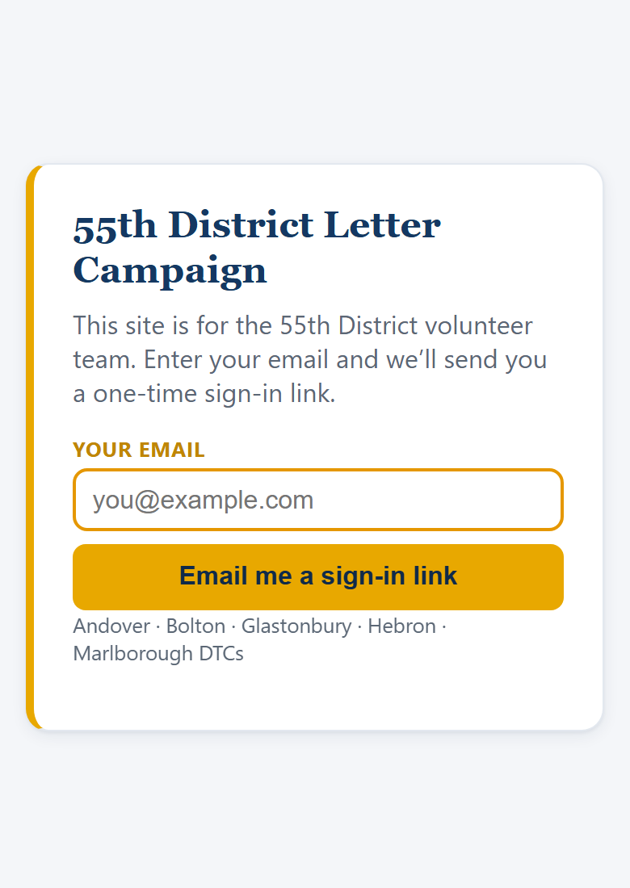
<figcaption>The sign-in page, as seen on a phone. This is also where the weekly email's "Open Speak Up" button lands if the volunteer's session has expired.</figcaption>
</figure>

The guided path: one decision per screen
----------------------------------------

Most volunteers arrive from a text or the weekly email, on a phone, meaning to
do one thing once. So the front door is a wizard, not a dashboard. It opens on
the current week and the week's topic, and asks a single question at a time.
Every step is in the page address, so the phone's Back button works, the
breadcrumb at the top jumps back to any earlier step, and a coordinator can text
someone a link that lands them three steps in.

<figure class="phones">
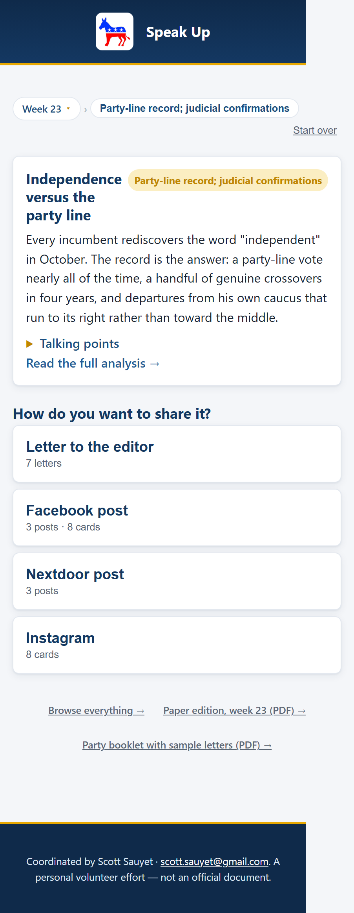
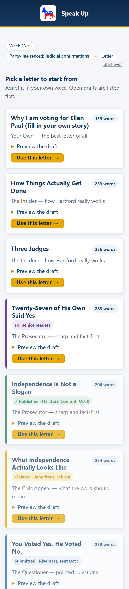
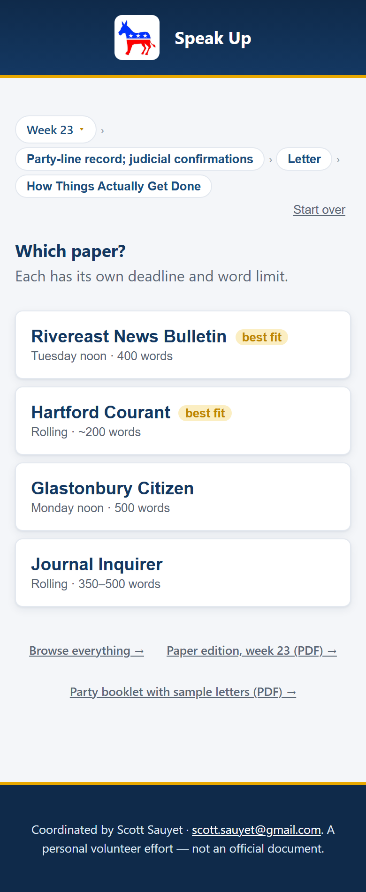
<figcaption>Left to right: how to share it (each choice shows how much material is behind it, and a choice with nothing behind it is disabled); pick a letter (open drafts first, taken ones dimmed with a status chip); pick a paper (deadline and word limit shown on the button, so the choice is informed).</figcaption>
</figure>

The last screen is the letter itself plus everything needed to send it: the
paper's email address, deadline, word limit and per-writer cap, the paper's
quirks ("send as a .txt or .doc attachment, not a PDF"), and the talking points
and writing advice folded away underneath.

<figure class="phones">
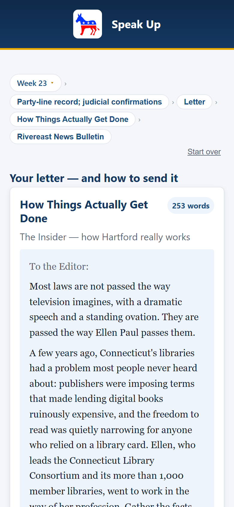
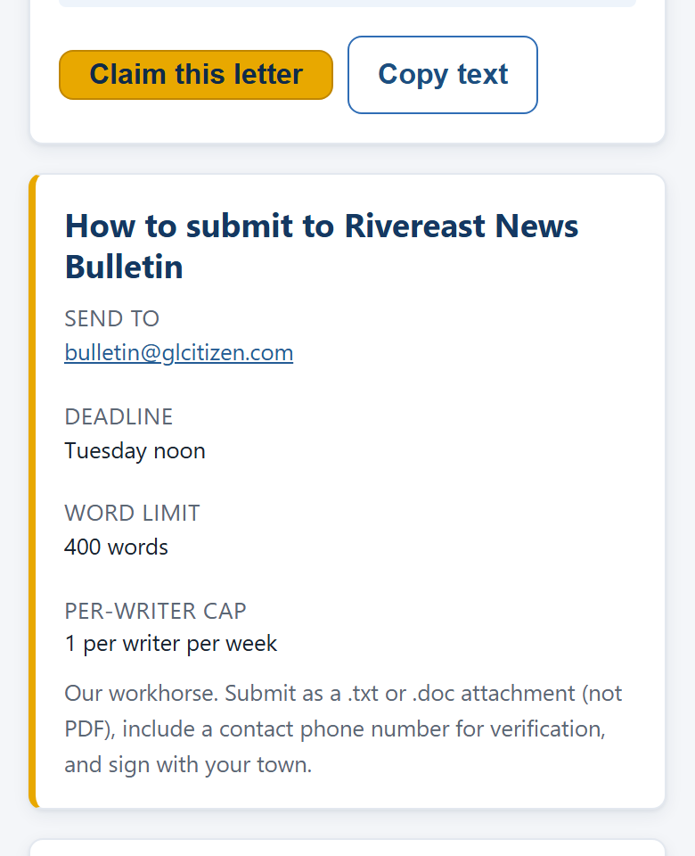
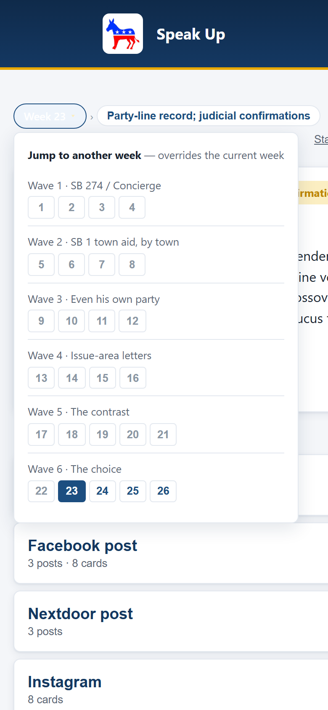
<figcaption>The letter and how to send it. "Claim this letter" takes it off the board for everyone else; "Copy text" puts it on the clipboard with a To the Editor line and a signature block to fill in. The week crumb (right) opens a picker for anyone who wants to work ahead or catch up.</figcaption>
</figure>

**Claims.** A sample letter is scarce: one writer, one paper. So letters carry a
status that everyone sees. *Open* means take it. *Claimed* shows the writer's
name. *Submitted* and *Published* carry a note like "Rivereast, Oct 9". Only the
writer who claimed a letter, or an admin, can move it forward or release it, and
the server refuses a claim on a letter someone else grabbed a moment earlier.
Volunteers are asked to adapt the draft in their own voice, not send it as is,
and the sample letters are written to make that easy.

The social side
---------------

A letter reaches people who read the paper; a post reaches everyone else. The
same wizard handles Facebook, Nextdoor and Instagram. A post or a card is not
scarce, since twenty people should share the same one, so there is nothing to
claim: the actions are "copy text" and "download image".

<figure class="phones">
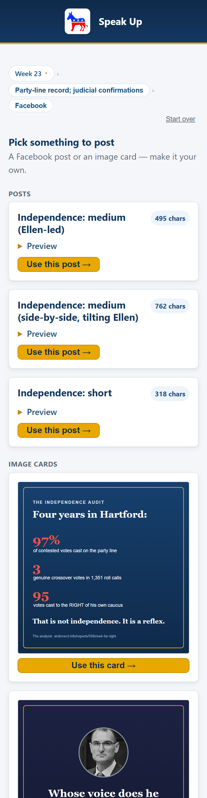
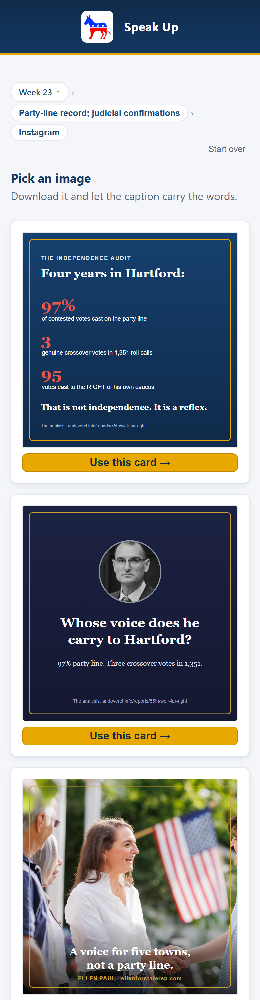
<figcaption>Facebook offers both text drafts and image cards; Instagram offers cards only. Each card is a 1080 by 1080 image rendered in the browser, so it downloads sharp and can be shuffled through five color schemes to keep a feed from looking like a template.</figcaption>
</figure>

Each post comes with a short publishing guide for the platform ("put the source
link in the first comment, not the post, so Facebook does not throttle it"), and
a pool of citations to rotate through so a dozen volunteers do not all post the
same link. Every factual claim in a card or post points at a public source: a
roll-call record, a news story, or one of our public analyses.

Browse everything: the dashboard
--------------------------------

The wizard is the front door, but a link on every screen opens the full
dashboard for the returning volunteer, the town point person, or anyone who
wants to survey the whole week. It is a different shape: the 26 weeks across the
top grouped by wave, the week's ask and open slots, two tabs for letters and
social, and a reference rail with the papers' rules, the writing advice, and the
evidence.

<figure class="pair">
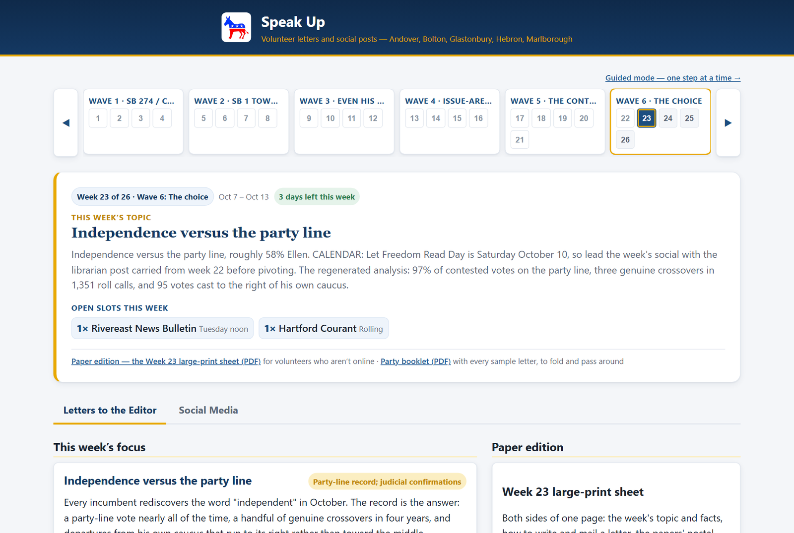
<figcaption>The dashboard on a desktop. The week strip shows the whole campaign at once; the hero shows the week's topic, the coordinator's note to writers, which papers still need a letter, and the printable editions.</figcaption>
</figure>

<figure class="pair">
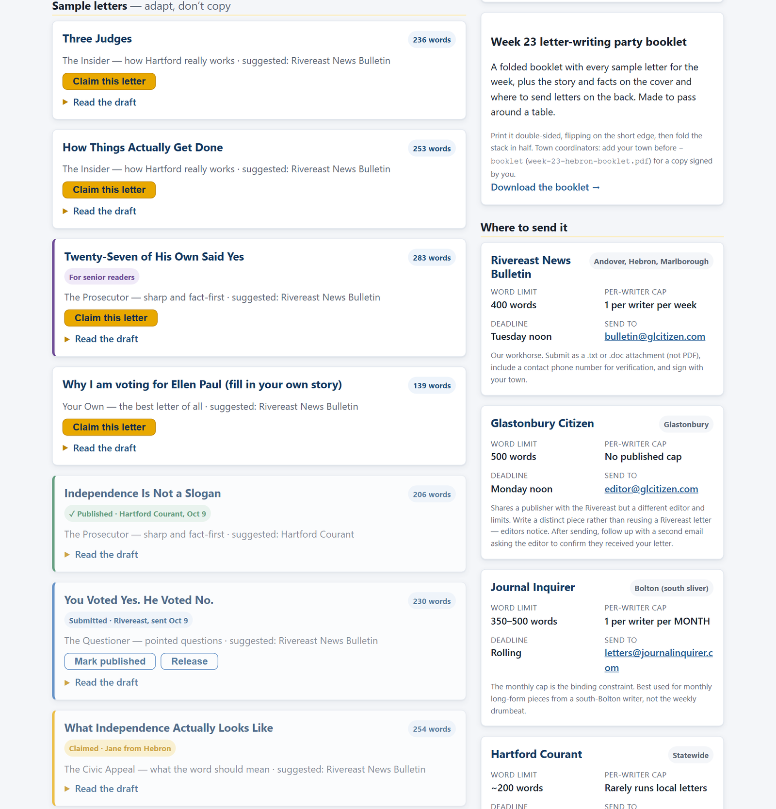
<figcaption>The Letters tab. Every sample letter for the week, its status, the ten personas, and the papers' word limits, deadlines and addresses alongside. Open drafts sort to the top.</figcaption>
</figure>

<figure class="pair">
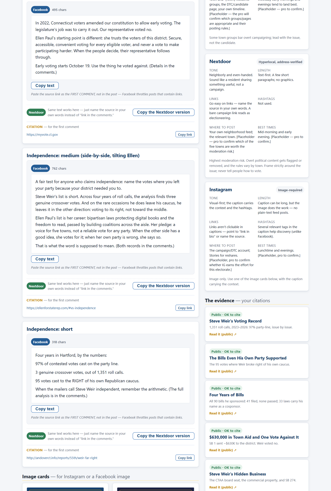
<figcaption>The Social tab: post drafts in a Facebook and a Nextdoor version, the card grid, and platform-by-platform posting advice.</figcaption>
</figure>

The weekly email
----------------

Volunteers get one email a week, Wednesday afternoon, timed so a writer has the
weekend before the papers' Monday and Tuesday deadlines. It is deliberately
thin: the week's theme, the open slots with deadlines and addresses, the topic
summary and talking points, one shareable card, and a button into the app.
Anything that will change during the week lives behind the button, not in the
email. There is a one-click unsubscribe, which drops the person from the email
list but not from the site.

<figure class="pair">
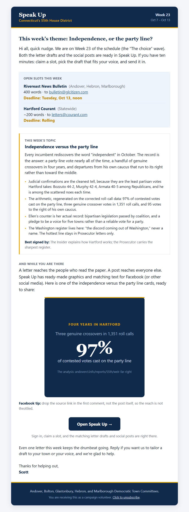
<figcaption>A week's email as it arrives. Everything on it is generated from the same content the app uses, so the email and the site never disagree.</figcaption>
</figure>

The paper edition, for volunteers who are not online
----------------------------------------------------

Some of our best writers have no internet. One is 88, sharp, and had her
internet taken away by her family after a run of scams. So every week is also
produced as a single sheet of paper in large type: the week's story and facts on
the front, how to write and mail a letter and the papers' postal addresses on
the back, with every date and address spelled out because the reader cannot
follow a link. It is handed out a week ahead so a mailed letter still beats the
deadline. There is a version per town, signed by that town's coordinator with
their phone number.

<figure class="pair">
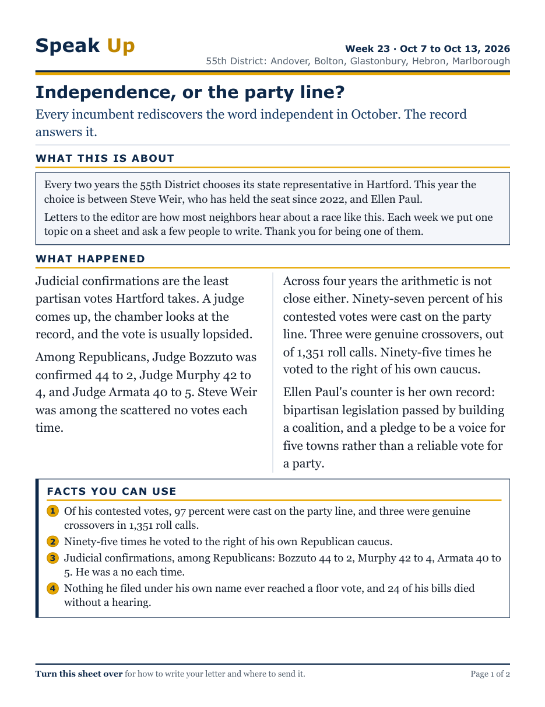
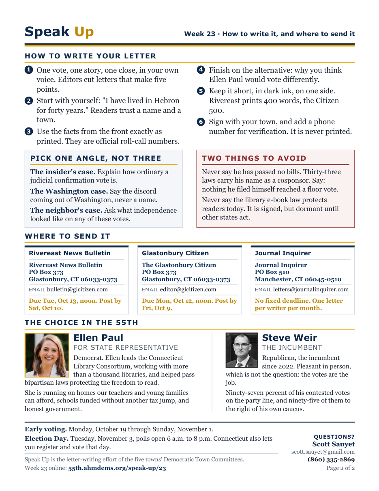
<figcaption>The large-print sheet, front and back, 14-point type on a single Letter page.</figcaption>
</figure>

For letter-writing parties there is a folded booklet: a cover with the week's
story, one sample letter per page, a make-your-own page, and a back cover with
where to send things.

<figure class="pair">
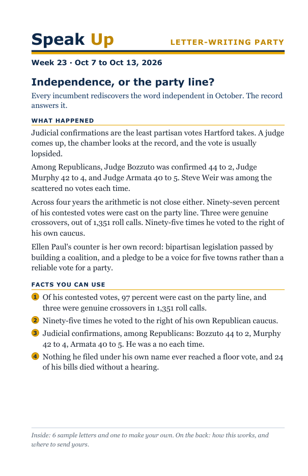
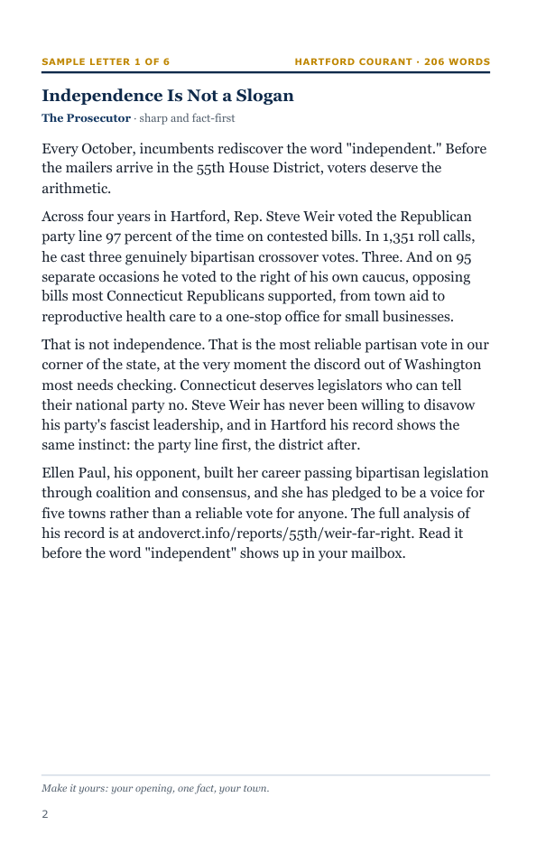
<figcaption>Two pages of the week 23 party booklet. It prints two-sided on ordinary paper and folds into order.</figcaption>
</figure>

Running it week to week
-----------------------

**Content.** The coordinator writes the week: the topic summary and talking
points, the sample letters (five or six a week, in different personas), the
post drafts, the cards. That is the real work, and no tool removes it. The
schedule itself (which week, which topic, how many letters in which paper) is a
single plain-text list, and each sample letter is its own plain-text file with a
few lines at the top (title, persona, topic, suggested paper). A short build
step on the coordinator's laptop turns those into what the site serves, and
the site's own guide is written so that a non-programmer can update a week.

**Admin tools in the browser.** Town point people sign in like anyone else, but
see an "Admin tools" link. From there they can add a volunteer (who can sign in
immediately), add a sample letter (live at once, no rebuild), and upload images
or PDFs for the social grid (a PDF, say a mailer, is split into page images in
the browser so each page becomes a postable image). Admins can also release or
reopen anyone's claim.

<figure class="pair">
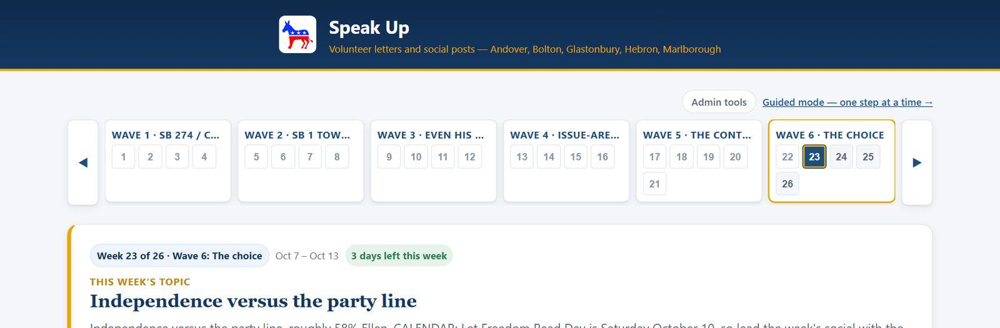
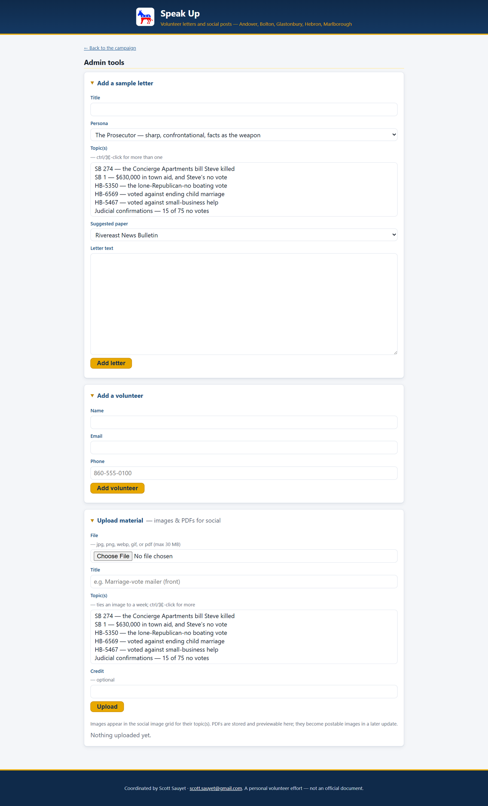
<figcaption>The admin link, and the admin tools page with all three panels open.</figcaption>
</figure>

**The email queue.** The weekly email is generated on the laptop and staged
onto the server weeks ahead; right now every remaining week is already queued.
An outside scheduler pings the server once an hour and any email that has come
due goes out, unless an admin has held or cancelled it. The queue page works
from a phone: preview, edit the subject or the opening paragraph, reschedule,
hold, cancel, or send now. The admin gets a heads-up email a day before each
send, so a quick "hold" from a phone is enough to stop a week. This was designed
around a two-week vacation with no laptop, and it held up.

<figure class="pair">
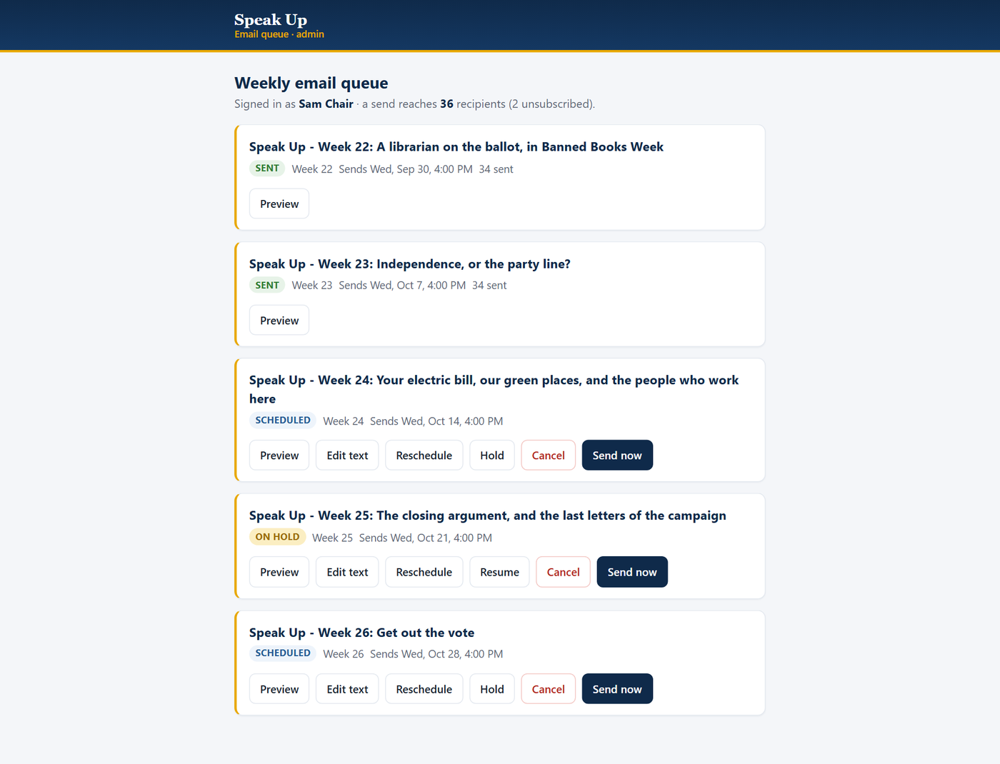
<figcaption>The queue, with two weeks sent, two scheduled and one on hold. The recipient count and the unsubscribes are shown at the top.</figcaption>
</figure>

**Backups.** The live state (claims, web-added letters, the roster) is a handful
of small files on the server; a one-command backup pulls them down, encrypted,
into the project.

What it runs on
---------------

This matters for the "could others use it" question, because the answer is
that it runs on almost nothing.

- **The site** is static pages and browser-side JavaScript. There is no
  framework and no build server; the laptop build is a few small scripts.
- **The live parts** (sign-in, claims, admin forms, uploads, the email queue)
  are about a dozen short PHP scripts, which means it runs on the cheapest
  shared hosting a town committee already has. Ours is on the DTC's existing
  host, in a subfolder.
- **Storage** is a few JSON files on the server, not a database. At our scale
  (under a hundred volunteers, a few hundred items) that is more than enough,
  and there is nothing to administer.
- **Email** goes out through the host's ordinary SMTP. The hourly "is anything
  due" ping comes from a free external cron service, because shared hosts do
  not reliably offer one.
- **Cost:** nothing beyond hosting we already paid for.

It was built by one person between the end of May and now, alongside writing
much of the content. A second campaign would not start from zero, but see the
sections that follow.

What it does not do
-------------------

- **It does not write the letters.** Every week's sample letters, posts and
  cards are written by hand and checked against public records. That is the
  job; the tool only distributes it. A campaign without someone willing to do
  that work each week gets nothing from this.
- **It does not know about your papers, towns or race.** Those are built in
  for the 55th. A second campaign would need its own set up.
- **Editing content means editing text files** on a laptop and running the
  build, except for the add-a-letter and upload forms. That is fine for one
  technically comfortable coordinator and would not be fine for most.
- **Claims are on the honor system.** The site records who claimed what; it
  cannot see what people actually send.
- **It does not track whether a letter ran.** The writer or an admin marks it
  published. We separately keep a clippings library of what the papers
  actually printed, but that is another tool.

What got built but not used
---------------------------

Some of this was built on a guess about how other people would work, and the
guess was wrong. The admin forms are the clearest case. Eight town point people
can add a volunteer or a sample letter from a phone, and as far as I can tell I
am the only one who ever has. The roster grew through me, and so did the
letters. The same goes for the content more broadly: the hope was that several
writers would contribute drafts in their own personas, and a few did, but the
great majority of the 119 letters and 77 posts came from one keyboard.

That is not a complaint about the volunteers. It is a lesson about the tool.
The parts that saw heavy use are the ones a volunteer meets on the way to doing
one thing: the sign-in link, the wizard, the claim button, the weekly email, the
paper sheet. The parts built for a distributed team of coordinators sat idle,
because the team never distributed itself that way. A general version should
probably start from the volunteer path, and treat shared authoring as a
question to settle with real users rather than a feature to build on
speculation.

Why it fit this race
--------------------

Some of what made Speak Up work is particular to the 55th and to this year, and
it is worth saying so before anyone imagines it dropping into a different race.

**We could write most of it up front.** The 55th leans Democratic by about nine
points in state and national races, yet the House seat has been held by one
Republican or another for nearly fifty years. The incumbent, Steve Weir, is
among the dozen most conservative members of the House, with four years of
roll-call votes behind him. So the campaign was built, from the first week,
almost entirely on his voting record, and there was plenty of it. A record does
not change from week to week, which meant the six waves and most of the sample
letters could be planned and written in the spring. We rarely felt a need to
react to the week's news or to the other side's letters. A campaign in a
different position, running on live issues or against a candidate without a
record, would feel the weekly deadline far more sharply, and the coordinator's
job would be closer to a newsroom's than to the one described above.

**The letters stood on research we had already done.** Speak Up was linked
throughout to our opposition research, which began as private pages on the
55th site and moved piece by piece onto the public andoverct.info as each part
was ready, so that a letter could cite it. Every claim had been checked against
the primary record before it reached a sample letter, which is why letters
built from the samples could go out in confidence that they would survive a
fact-check. A campaign without that body of work would have to build it as it
went, or write more cautiously.

**One piece of research has never been public: the one on our own candidate.**
Ellen Paul has strong credentials and a good story, and the file on her was
compiled from the public record alone, not from her own material, as a
preemptive answer to whatever opposition research the other side might run. It
has not been needed. But it shaped what the letters could safely say about her,
and it is work another campaign would have to do for itself.

Put together, these say that the tool worked partly because the race let it.
Whether it would carry its weight somewhere else depends on things no tool
controls: an opponent with a record to run against, time to write ahead, and
research solid enough to cite.

What a general-purpose version would need
-----------------------------------------

If chairs think this is worth having, here is roughly what it would take to go
from "ours" to "anyone's", in order of importance:

1. **Per-campaign setup in the browser:** the race, the towns, the papers and
   their rules, the volunteer roster (imported from a spreadsheet), and the
   week schedule, all editable by a coordinator without a laptop build.
2. **Content editing in the browser:** sample letters, post drafts and talking
   points written and edited on the site, with a review step before volunteers
   see them. The card designer would need a few templates a coordinator can
   fill in rather than hand-made cards.
3. **One hosted copy for everyone,** or a packaged copy each campaign installs
   on its own host. Hosted is easier for chairs and harder for whoever runs it;
   installed is the reverse.
4. **A shared library.** The papers and their rules are the same for every
   campaign in a region, and so is a lot of the writing advice. Those could be
   maintained once.
5. **The things we never got to:** text-message nudges (we already collect
   phone numbers), a simple "what ran this week" view fed by the published
   marks, and a light analytics page so a chair can see claims and sends per
   week without asking.

I would guess that a usable general version is two months' after-hours work for
one person, not a weekend, and that it needs two or three campaigns willing to
use it in the spring and tell us what is wrong with it.

Questions for you
-----------------

I would rather hear "we would never use this" now than build it and find out.
In the chairs' chat, or by email to scott.sauyet@gmail.com:

1. Does your committee or campaign run a letters-to-the-editor effort today,
   and how? A group text? A spreadsheet? Nothing organized?
2. Which of the pieces above would you actually use: the guided letter path,
   the claims, the social cards, the weekly email, the paper edition? Which
   would you skip?
3. Who on your side would do the weekly content? Is there a person who would
   write five sample letters a week, or would you want the tool to help draft
   them?
4. Would you rather sign in to a shared hosted copy run by someone else, or
   install your own?
5. What papers cover you, and what do their letter rules look like? (The more
   of those we collect, the more of the setup can be shared.)
6. Is there anything here you think is a bad idea?

If there is interest, I am glad to give a live walk-through, and to add any
chair to the live site as a volunteer so you can try it yourself.
