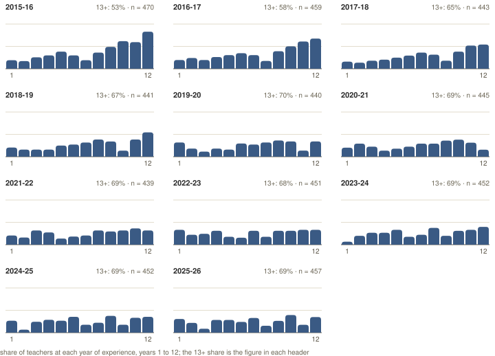
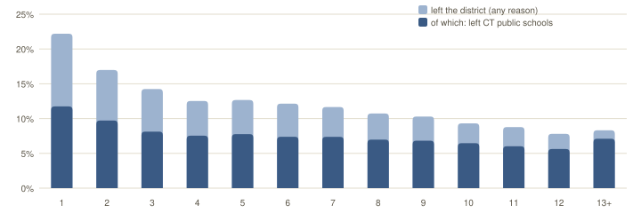
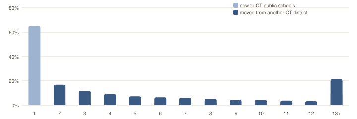
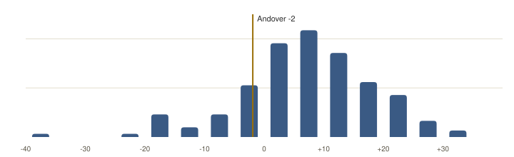
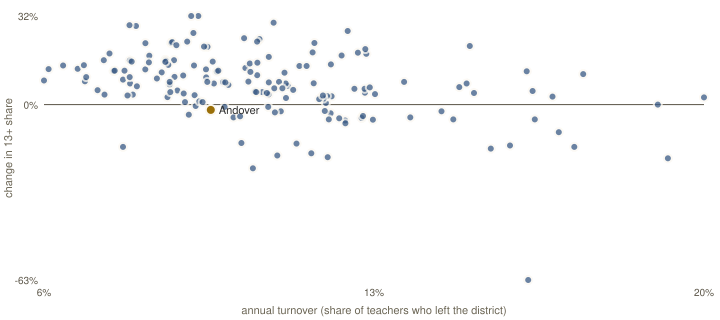
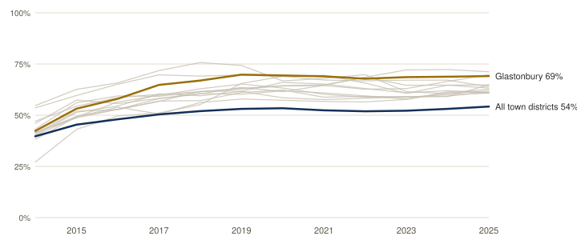
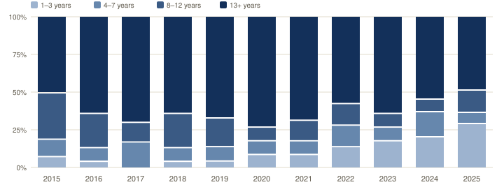

Do Teachers “All End Up at the Top Step”?
=========================================

*This report uses a teacher-level extract from the Connecticut State Department
of Education (CSDE): one record per classroom teacher per assignment per year,
for every public school district in the state, for the twelve school years
2014-15 through 2025-26. CSDE's Performance Office delivered it on October 23,
2026 in response to a data request, and confirmed the field definitions used
here on November 23, 2026. The extract covers general-education and
special-education classroom teachers; its full-time-equivalent (FTE) totals tie
to CSDE's published FTE Staffing report within 0.1% statewide for 2016 through
2023. Four choices shape every figure. Experience is a count of school years
taught in Connecticut public schools since 2002-03, including the current year,
so a first-year teacher is at year 1; service before 2014-15 is capped at 13, so
"13 or more" is the top band, exact in every year, and because the state's
records begin in 2002-03 every experience figure is a floor on real experience.
Counts are head counts, one record per teacher per year, assigned to the
district holding most of their FTE. Statewide figures cover the 167 local and
regional school districts only; charter, magnet, technical and state-agency
schools are excluded from comparisons. The 2014-15 extract is about 4% short of
the published teacher count, so it serves as a roster baseline but not as a
level, and every time series starts in 2015-16.*

Overview
--------

At the Andover Board of Finance's regular meeting on May 27, 2026, First
Selectman Jeff Maguire urged the board to read the new teachers' contract and
"see what's going to happen in 10 years when all these young people are all at
the top step. How is this town going to afford it?" ([Board of Finance, May 27,
2026, at
53:11](https://andoverct.info/reference/video/transcripts/6v44_LJvRvk.html#t3191);
machine transcript, the recording is authoritative.)

The remark describes a mechanism, and the mechanism is testable. If a district's
teachers stay put, every one of them is ten steps further along the salary
schedule in ten years, and a young staff becomes an expensive one. If teachers
leave and are replaced, the schedule refills from the bottom and the mix stays
roughly where it was. Which of these happens in Connecticut is not a matter of
opinion: the state keeps a record of every teacher in every district every year,
and that record can be followed forward.

This report follows it. It asks four questions:

1. Does the distribution of teachers across years of experience drift upward
   over time, in the state as a whole and in individual districts?
2. What does the churn behind that distribution look like: who leaves, at what
   point in a career, and who replaces them?
3. What would the no-churn model have predicted ten years ago, and how does that
   compare with what actually happened?
4. Where does Andover sit, among the state's districts and among the 45
   elementary-only districts it is usually compared with?

The answers, in brief: the shape of the workforce is nearly the same every year;
roughly one teacher in twelve leaves their district each year and one in
fourteen leaves Connecticut public schools altogether; the no-churn model
predicted that every teacher on a 2014 roster would be at the top step by 2024
and the actual share was about three in five; and Andover's experience mix is
where it was a decade ago, with a cluster of recent hires that the churn figures
say will thin out the way every such cluster does.

A Note on the Numbers Before the Figures
----------------------------------------

**What "top step" means.** The Andover Board of Education's contract with the
Andover Education Association for 2025–2029 ([Appendix
B](aea-contract-2025-2029.pdf)) has ten salary steps in each of five degree
lanes, and eligible teachers advance one step each July 1. The top step is
therefore ten years of credited service, and a teacher hired at step 1 reaches
it in their tenth year. Placement on the schedule credits prior teaching in
public, private and military dependency schools (Article 6), so a teacher's step
is at least the number of years this report can count for them. Where the report
gives a share of teachers "at 10 or more years," the share at the top step is at
least that high.

**Why the top band is 13 or more.** CSDE's record of certified staff begins with
2002-03, so the extract counts a teacher's pre-2014 service only back to that
year and caps it at 13. Any threshold at or below 13 years is exact in every
year of the panel, which is why the report's bands are 1–3, 4–7, 8–12 and 13 or
more, and why the contract's threshold of 10 can be applied directly. What
cannot be seen is how far above 13 a senior teacher sits: a "13" in 2014-15 may
have been teaching since 1985. Medians and means are reported only where the cap
does not affect them.

**Head counts, not FTE.** A teacher is a teacher whether at 0.6 FTE or 1.0; the
claim under test is about people on steps. Part 2 shows the result FTE-weighted
as well, and it does not change.

**Why the series start in 2015-16.** The 2014-15 extract has about 4% fewer
teachers than CSDE's published count for that year (the published count for
every later year ties within 0.5%). Nothing in this report uses 2014-15 as a
level. It is used once, as the roster that the ten-year test ages forward, where
a slightly short roster makes no difference to a share.

**Suppression.** Published tables give district counts only in the four bands
above. No table identifies an individual teacher's year of service, and nothing
about any teacher's arrival or departure is published below the district total.

Part 1 — The shape of the workforce, year by year
-------------------------------------------------

Figure 1 shows the share of town-district teachers at each year of experience
from 1 to 12, one panel per school year. The 13-or-more group, which holds about
half of all teachers, is given as a figure in each panel's header rather than
drawn as a bar, because as a bar it would be four times the height of any other
and flatten the shape that matters.

The first twelve years are nearly level in every panel. There is a shallow
trough that walks rightward one year at a time (the small cohorts hired during
the 2008–2012 recession) and a bump behind it (the larger cohorts hired after),
but neither changes the picture: Connecticut's districts carry roughly as many
first-year teachers as sixth-year or eleventh-year teachers, year after year.

The one number that moves is the 13-or-more share, from 45% in 2015-16 to 54% in
2025-26. Most of that rise came in three years, 2015-16 to 2018-19, and it has
been nearly flat since. Part 4 shows what it was: the large cohorts hired in the
early 2000s crossing the 13-year line, after which the line was behind them. At
the contract's threshold of ten years, where the early-2000s cohorts had already
crossed by 2015, the share moved from 61% to 65% over the same decade.

Glastonbury is the clearest single-district example of a hiring wave passing
through, and Figure 2 shows it: a bulge at years 9 through 12 in 2015-16 that
reaches the 13-year line by 2018-19 and then disappears into the header figure,
which rises from 53% to 70% and then holds.

### Town districts, 2015-16 to 2025-26 ✓ *Confirmed from the CSDE extract* ###

| School year | Teachers | Students | Teachers per 100 | Median years | 1–3   | 4–7   | 8–12  | 13 or more | 10 or more | Retained next year |
| ----------- | -------- | -------- | ---------------- | ------------ | ----- | ----- | ----- | ---------- | ---------- | ------------------ |
| 2015-16     | 39,161   | 503,278  | 7.63             | 12           | 15.3% | 14.8% | 24.4% | 45.4%      | 61.1%      | 92.6%              |
| 2016-17     | 39,297   | 499,780  | 7.72             | 12           | 14.5% | 16.3% | 21.2% | 48.0%      | 62.1%      | 92.5%              |
| 2017-18     | 39,016   | 495,261  | 7.74             | 13           | 12.9% | 17.5% | 19.2% | 50.4%      | 63.4%      | 92.7%              |
| 2018-19     | 38,845   | 490,748  | 7.78             | 13           | 12.2% | 17.9% | 17.9% | 52.0%      | 63.2%      | 92.2%              |
| 2019-20     | 38,726   | 487,319  | 7.82             | 13           | 12.3% | 17.2% | 17.4% | 53.1%      | 63.0%      | 92.7%              |
| 2020-21     | 38,795   | 472,479  | 8.08             | 13           | 13.1% | 16.1% | 17.4% | 53.4%      | 62.7%      | 91.9%              |
| 2021-22     | 39,224   | 472,658  | 8.19             | 13           | 14.5% | 14.9% | 18.2% | 52.4%      | 62.2%      | 91.2%              |
| 2022-23     | 39,224   | 472,890  | 8.18             | 13           | 15.4% | 14.4% | 18.3% | 51.9%      | 62.3%      | 92.0%              |
| 2023-24     | 39,095   | 472,242  | 8.17             | 13           | 15.2% | 14.4% | 18.2% | 52.2%      | 63.3%      | 92.3%              |
| 2024-25     | 38,757   | 467,631  | 8.19             | 13           | 13.6% | 15.7% | 17.6% | 53.1%      | 64.3%      | 92.9%              |
| 2025-26     | 38,554   | 456,637  | 8.35             | 14           | 12.3% | 16.4% | 17.1% | 54.2%      | 65.0%      |                    |

> **Notes:** Local and regional school districts only. Students are the October
> enrollment count from EdSight for the same school year. "Retained next year"
> is the share of the year's teachers who taught in the same district the
> following year, so it is blank for 2025-26. The 2025-26 median of 14 is exact:
> the cap affects a median only above 13 + (years since 2014), and no year's
> median comes close. The share at 1–3 years was between 12% and 16% in every
> year, which is the arithmetic behind the churn figures in Part 3: about one
> teacher in twenty-five is in their first year, every year.

Part 2 — The ten-year test
--------------------------

The claim is a prediction, so it can be run backward. Take every teacher on a
district's 2014-15 roster, add ten years to each, and let nobody leave or
arrive. That is the no-churn model, and it is exactly what "in ten years they
will all be at the top step" describes. Then compare the result with the people
who were actually teaching in that district in 2024-25.

At the contract's threshold the model's prediction is 100% by construction:
every teacher on a 2014-15 roster had at least one year of service, so ten years
later every one of them is past step 10. At the data's own top band, 13 or more,
the model predicts between 89% and 95% depending on the group, because a few
2014-15 first- and second-year teachers would still be short of 13.

- **100%** — share of 2014-15 teachers the no-churn model puts at the top step
  by 2024-25, in every district
- **64%** — actual share of town-district teachers at 10 or more years in
  2024-25
- **58%** — the actual share in Andover: 14 of 24 teachers
- **59%** — share of the 2014-15 town-district roster still teaching in a town
  district in 2024-25; in Andover, 11 of 22

The model is not a little wrong. It is wrong by a third of the workforce.

### Does the result survive its assumptions? ###

The test was run eight ways: two ten-year windows, head count and FTE-weighted,
the data's 13-year band and the contract's 10-year threshold, and an alternative
reading of the experience field that adds a year to everyone present in 2014-15
(which can only raise the prediction). Each cell reads predicted → actual.

| Variant                                         | Town districts | 45 peers   | Glastonbury | Andover    |
| ----------------------------------------------- | -------------- | ---------- | ----------- | ---------- |
| 2014-15 → 2024-25, at 10 or more years          | 100% → 64%     | 100% → 62% | 100% → 77%  | 100% → 58% |
| 2015-16 → 2025-26, at 10 or more years          | 100% → 65%     | 100% → 63% | 100% → 78%  | 100% → 56% |
| 2014-15 → 2024-25, at 10 or more, FTE-weighted  | 100% → 64%     | 100% → 62% | 100% → 77%  | 100% → 57% |
| 2014-15 → 2024-25, at 13 or more years          | 89% → 53%      | 91% → 51%  | 95% → 69%   | 91% → 54%  |
| 2015-16 → 2025-26, at 13 or more years          | 90% → 54%      | 91% → 52%  | 96% → 69%   | 100% → 48% |
| 2014-15 → 2024-25, at 13 or more, FTE-weighted  | 89% → 53%      | 91% → 51%  | 95% → 68%   | 91% → 52%  |
| 2015-16 → 2025-26, at 13 or more, FTE-weighted  | 90% → 54%      | 91% → 52%  | 97% → 69%   | 100% → 47% |
| 2014-15 → 2024-25, alternative experience count | 94% → 56%      | 95% → 54%  | 98% → 72%   | 100% → 54% |

> **Notes:** "45 peers" are the elementary-only districts used in [Andover's
> Per-Pupil Spending in Context](/reports/aes/peer-spending/), Norwich excluded.
> Glastonbury is included as the state's clearest hiring-wave district (Part 4);
> even there, where the senior share really did rise, the gap between model and
> reality is 23 points. The alternative count treats 2014-15 as outside the
> pre-2014 service field; CSDE confirmed on November 23, 2026 that it is inside,
> so the first row is the correct reading and the last is an upper bound.

The gap does not depend on the threshold, the window, the weighting or the
counting rule. It is between 22 and 42 points everywhere, and it is the same
thing in every case: the people who were not there anymore.

Part 3 — Who leaves, who arrives
--------------------------------

The no-churn model fails because teachers leave, and the record shows exactly
when. Figure 4 pools every town-district teacher-year from 2015-16 through
2023-24 and asks, for each year of experience, what share did not teach in the
same district the following year, and what share did not teach in any
Connecticut public school.

A first-year teacher has a 22% chance of not being in the same district next
year and a 12% chance of not being in Connecticut public schools at all. Both
rates fall steadily with experience, to 8% and 6% by year twelve. The senior
group leaves at about the same rate as a twelfth-year teacher, but nearly all of
its departures are departures from the system: that is retirement.

### Where the replacements come from ###

Two kinds of teacher arrive in a district. Those new to Connecticut public
schools arrive overwhelmingly at the bottom: 65% are at year 1 as this report
counts it, and almost all the rest are within a few years of it (some have
taught elsewhere, which the state's records do not see). Those who move from
another Connecticut district arrive at every point in a career, 29% within their
first three years and 21% already past thirteen. Over 2015-16 to 2025-26, town
districts took in 31,080 teacher-years of the first kind and 13,149 of the
second.

### A cohort followed for ten years ###

Figure 6 takes every town-district teacher of 2015-16, groups them by their
experience that year, and asks where they were in 2025-26.

| Years in 2015-16 | Teachers | In a CT town district, 2025-26 | In the same district |
| ---------------- | -------- | ------------------------------ | -------------------- |
| 1                | 1,964    | 59%                            | 33%                  |
| 2                | 2,083    | 62%                            | 40%                  |
| 3                | 1,947    | 63%                            | 43%                  |
| 4                | 1,755    | 67%                            | 47%                  |
| 5                | 1,525    | 68%                            | 49%                  |
| 6                | 1,349    | 67%                            | 48%                  |
| 7                | 1,180    | 69%                            | 51%                  |
| 8                | 1,643    | 71%                            | 57%                  |
| 9                | 1,786    | 72%                            | 58%                  |
| 10               | 1,908    | 71%                            | 60%                  |
| 11               | 1,999    | 68%                            | 59%                  |
| 12               | 2,238    | 66%                            | 58%                  |
| 13 or more       | 17,784   | 46%                            | 43%                  |

> **Notes:** Pooled exit rates in Figure 4 cover 2015-16 through 2023-24 (the
> last year with a following year). The cohort in Figure 6 and the table is the
> 2015-16 roster of all town districts, 39,161 teachers; "in the same district"
> means the district that held most of the teacher's FTE in both years. A
> teacher who left and came back counts as present. CSDE publishes a statewide
> educator attrition rate on EdSight; it does not break attrition out by career
> stage, which is what this part adds.

This is the ten-year claim seen from the other side. Of the first-year teachers
of 2015-16, the "young people" of that year, 59% were teaching in a Connecticut
town district ten years later and only a third were in the district that hired
them. The cohorts most likely to still be in place after a decade are the ones
that were already eight to ten years in, and even they lose two in five.

Part 4 — Where composition does drift
-------------------------------------

Churn does not make drift impossible. A district that stops hiring, or hires a
large cohort all at once, will see its experience mix move. This part asks how
much it moves, in which districts, and what goes with it.

Figure 7 shows the change in the 13-or-more share from 2015-16 to 2025-26 for
each of the 160 town districts with at least ten teachers in both years.

The median district moved up 8 points in ten years. Forty-five districts stayed
within 5 points of where they started, 86 within 10, and 74 moved more than 10
points in one direction or the other. The drift is real, it is upward on
average, and it is about a point a year.

### What goes with it ###

Four things might explain which districts drifted: size, turnover, enrollment
change and student need. Only one of them does much.

| Against the ten-year change in the 13+ share | Correlation (r) | Districts |
| -------------------------------------------- | --------------- | --------- |
| Annual turnover (share leaving the district) | −0.41           | 160       |
| District size (log of teacher count)         | +0.31           | 160       |
| Share of students classified high-needs      | −0.18           | 160       |
| Enrollment change, 2015-16 to 2025-26        | −0.16           | 159       |
| Teacher-count change, 2015-16 to 2025-26     | −0.08           | 160       |

Turnover is the one that carries the finding: the districts whose senior share
rose are the districts where fewer people leave each year. Size matters because
small districts bounce (a district with twelve teachers moves 8 points when one
of them retires), not because large districts drift more; the yearly shape shift
correlates with log size at r = −0.85, and the median district under 50 teachers
moved only 1 point net over the decade while moving 10 points in absolute terms.
Need and enrollment barely register once turnover is in view.

| Teachers in 2025-26 | Districts | Median change | Median absolute change | Median yearly shape shift | Median turnover |
| ------------------- | --------- | ------------- | ---------------------- | ------------------------- | --------------- |
| Under 50            | 34        | +1 pts        | 10 pts                 | 0.56 years                | 12.0%           |
| 50–149              | 42        | +7 pts        | 8 pts                  | 0.33 years                | 10.7%           |
| 150–399             | 58        | +9 pts        | 9 pts                  | 0.23 years                | 9.6%            |
| 400 or more         | 26        | +9 pts        | 9 pts                  | 0.19 years                | 9.2%            |

> **Notes:** Turnover is the mean over 2015-16 to 2024-25 of the share of a
> district's teachers who did not teach there the next year. The yearly shape
> shift is the earth-mover distance between consecutive years' experience
> distributions (capped at 13), in years: how far the distribution had to move,
> on average, from one year to the next. Student need is the share of a
> district's ELA test takers classified high-needs on EdSight, latest year.
> Correlations are Pearson's r on district-level values; none of the four is
> presented as a cause.

### Hiring waves ###

The upward drift has a recognizable source. Thirteen districts of the 103 with
at least a hundred teachers entered the panel with a pronounced bulge at years
10 through 12 of experience: the cohorts hired in the early 2000s, when
enrollment was peaking. Figure 9 follows their 13-or-more share.

| District      | Teachers, 2014-15 | 13 or more, 2014-15 | Peak | Peak year | 13 or more, 2025-26 |
| ------------- | ----------------- | ------------------- | ---- | --------- | ------------------- |
| Mansfield     | 106               | 55%                 | 76%  | 2018-19   | 62%                 |
| Rocky Hill    | 190               | 41%                 | 65%  | 2025-26   | 65%                 |
| Waterford     | 192               | 43%                 | 69%  | 2022-23   | 65%                 |
| Monroe        | 235               | 54%                 | 70%  | 2017-18   | 63%                 |
| Glastonbury   | 449               | 42%                 | 70%  | 2019-20   | 69%                 |
| Madison       | 258               | 27%                 | 69%  | 2020-21   | 64%                 |
| Wethersfield  | 247               | 41%                 | 66%  | 2020-21   | 61%                 |
| North Haven   | 248               | 46%                 | 63%  | 2025-26   | 63%                 |
| East Lyme     | 240               | 40%                 | 61%  | 2024-25   | 61%                 |
| Wallingford   | 463               | 47%                 | 70%  | 2025-26   | 70%                 |
| Seymour       | 161               | 42%                 | 72%  | 2024-25   | 71%                 |
| Wolcott       | 186               | 38%                 | 65%  | 2019-20   | 61%                 |
| South Windsor | 337               | 40%                 | 62%  | 2019-20   | 61%                 |

> **Notes:** A district qualifies if its 2014-15 roster had at least 2.2 times
> as many teachers per year of experience at years 10–12 as at years 1–9. The
> 2014-15 roster is used here as a shape, not a level.

Every one of the thirteen rose by 15 to 42 points as the wave crossed the
13-year line, and then the rise stopped. Eight had peaked by 2020-21; five of
those have since fallen back by 5 to 14 points as the wave reached retirement.
Five (Rocky Hill, North Haven, East Lyme, Wallingford and Seymour) were still at
their peak in 2024-25 or 2025-26, and they share a profile: annual turnover of
6% to 10%, below the state's median, and enrollment down 2% to 15% over the
decade, so they have hired little. That is what a rising senior share looks like
in practice. It is a district that stopped hiring, not a district whose contract
aged.

Closer to home, the same pattern appears in the region's own districts.
Regional School District 8 (RHAM), whose enrollment fell 36% between 2015-16
and 2025-26 on EdSight's count, saw its 13-or-more share go from 37% to 69%, a
32-point rise that ties Regional District 13 for the largest of any district in
the state with more than a hundred teachers; six of the eight largest rises
in the state belong to districts whose enrollment fell by a quarter or more. Hebron's
share went from 40% to 59%, Marlborough's from 53% to 67%. Andover's did not
move.

Part 5 — Andover
----------------

Andover Elementary School employed between 21 and 27 classroom teachers in each
year of the panel, so a single hire or retirement moves its percentages by four
points and the counts are the honest unit. Figure 10 and the table give them.

### Andover, 2015-16 to 2025-26 ✓ *Confirmed from the CSDE extract; FTE ties to EdSight exactly from 2016-17* ###

| School year | Teachers | FTE  | Students | Teachers per 100 | Median years | 1–3 | 4–7 | 8–12 | 13 or more | 10 or more | Arrived | Left after |
| ----------- | -------- | ---- | -------- | ---------------- | ------------ | --- | --- | ---- | ---------- | ---------- | ------- | ---------- |
| 2015-16     | 26       | 24.8 | 250      | 9.92             | 12.5         | 2   | 3   | 8    | 13         | 17         | 4       | 5          |
| 2016-17     | 22       | 20.8 | 225      | 9.24             | 14           | 1   | 2   | 5    | 14         | 17         | 1       | 2          |
| 2017-18     | 23       | 21.8 | 204      | 10.69            | 15           | 0   | 4   | 3    | 16         | 18         | 3       | 3          |
| 2018-19     | 22       | 20.9 | 191      | 10.94            | 14.5         | 1   | 2   | 5    | 14         | 17         | 2       | 3          |
| 2019-20     | 21       | 19.3 | 195      | 9.90             | 16           | 1   | 2   | 4    | 14         | 17         | 2       | 0          |
| 2020-21     | 22       | 20.3 | 174      | 11.67            | 16.5         | 2   | 2   | 2    | 16         | 18         | 1       | 3          |
| 2021-22     | 22       | 20.3 | 192      | 10.57            | 17           | 2   | 2   | 3    | 15         | 17         | 3       | 4          |
| 2022-23     | 21       | 19.8 | 197      | 10.05            | 15           | 3   | 3   | 3    | 12         | 14         | 3       | 0          |
| 2023-24     | 22       | 20.3 | 205      | 9.90             | 15.5         | 4   | 2   | 2    | 14         | 15         | 1       | 1          |
| 2024-25     | 24       | 22.3 | 239      | 9.33             | 14           | 5   | 4   | 2    | 13         | 14         | 3       | 1          |
| 2025-26     | 27       | 25.8 | 245      | 10.53            | 12           | 8   | 2   | 4    | 13         | 15         | 4       |            |

> **Notes:** "Arrived" is the number of the year's teachers who did not teach in
> Andover the year before; "Left after" is the number who did not teach in
> Andover the following year, whether they moved to another district or left
> Connecticut public schools. Both are counts of people, with nothing about
> which people. Andover's FTE in the extract matches EdSight's published
> general- plus special-education teacher FTE to the tenth in every year from
> 2016-17 on. Students are EdSight October enrollment.

Three things stand out.

**The senior share has not moved.** Thirteen of Andover's teachers were at 13 or
more years in 2015-16 and thirteen were in 2025-26; the count has been between
12 and 16 in every year of the decade. At the contract's threshold the share
went from 65% (17 of 26) to 56% (15 of 27). Among the 45 peer districts,
Andover's ten-year change ranks 26th of 45, in the middle.

**The recent hiring is real.** From 2015-16 through 2021-22 Andover never had
more than two teachers in their first three years. In 2025-26 it had eight,
after taking on eleven teachers in four years while losing only two. That
cluster at the bottom of the schedule is what the May 27 remark described, and
on the numbers it is accurately described: nearly a third of the current staff
is within three years of the start.

**The churn figures say what happens next.** Part 3 found that of first-year
teachers, 59% are still in Connecticut public schools after ten years and 33%
are still in the district that hired them; for teachers two or three years in,
the same-district figure is 40% to 43%. Applied to Andover's eight early-career
teachers, the expectation is that three or four of them will be at Andover's top
step in 2035-36, not eight. Andover's own record over the decade points the same
way: of the 22 teachers on the 2014-15 roster, 11 were still there in 2024-25.

Figure 11 puts Andover among its peers. The peer median share at 13 or more
moved from 51% to 52% in ten years; at 10 or more, from 66% to 63%. Small
elementary districts, taken together, are not getting more senior. Andover's
line is more volatile than the median, as every line of a 22-teacher district
is, and it ends within four points of where it began.

Summary Table
-------------

| Question                                                           | Answer                                                                                                                                                 |
| ------------------------------------------------------------------ | ------------------------------------------------------------------------------------------------------------------------------------------------------ |
| Does the experience distribution drift upward statewide?           | Slowly. The 13-or-more share in town districts rose from 45% to 54% in a decade, nearly all of it by 2018-19; the 10-or-more share rose from 61% to 65%. |
| What did the no-churn model predict?                               | That 100% of each 2014-15 roster would be at the top step by 2024-25. The actual share was 64% statewide, 62% among peers, 58% in Andover.             |
| How much churn is there?                                           | About 8% of teachers leave their district each year and 7% leave Connecticut public schools; first-year teachers leave at 22% and 12%.                 |
| Where does the senior share rise?                                  | Where hiring stops: the drift correlates with low turnover (r = −0.41) and not with size, need or enrollment. Hiring waves raise it for four or five years, then retirement caps it. |
| Is Andover's workforce getting more senior?                        | No. Thirteen teachers at 13 or more years in 2015-16 and thirteen in 2025-26; the share at the top step went from 65% to 56%.                            |
| What becomes of Andover's recent hires?                            | On the state's ten-year survival rates, three or four of the eight early-career teachers of 2025-26 would be expected at Andover's top step in 2035-36.   |

Key Observations
----------------

**The no-churn model is wrong by a third of the workforce, everywhere.** It
predicts that every 2014-15 teacher is at the top step in 2024-25. The actual
share at ten or more years is 64% across the state's town districts, 62% in
Andover's peer group, 77% in the district with the state's strongest hiring
wave, and 58% in Andover. No window, weighting or counting rule narrows the gap
below 22 points.

**The shape of the workforce is stable.** The share of town-district teachers in
their first three years was between 12% and 16% in every one of eleven years;
the median years of experience moved from 12 to 14. A district refills from the
bottom at about the rate it empties from the top, and Connecticut's roughly
39,000 classroom teachers look much the same in 2025-26 as in 2015-16.

**Drift exists, and it is small.** The median district's 13-or-more share rose 8
points in ten years, about a point a year. The statewide rise is mostly the
large early-2000s cohorts crossing the 13-year line between 2015-16 and 2018-19;
at the contract's own ten-year threshold the decade's change is 4 points.

**Drift follows hiring, not contracts.** The districts whose senior share rose
are the ones with the lowest turnover and the least hiring, including five whose
enrollment fell and whose hiring-wave cohort is still in place. Every
Connecticut district has a step schedule; only the ones that stopped hiring
drifted.

**Andover is not drifting.** Its senior count has been 12 to 16 teachers in
every year of the decade, its ten-year change ranks in the middle of its peers,
and the peer group as a whole moved one point. What changed at Andover is a
cluster of eleven hires in four years, visible as eight teachers at years 1 to 3
in 2025-26 against none to two in the years before 2022.

**A new cohort thins by half in a decade.** Of the state's 2015-16 first-year
teachers, 59% were still in Connecticut public schools in 2025-26 and 33% were
in the district that hired them; of Andover's own 2014-15 roster, half remained
in 2024-25. The remark's arithmetic holds only for the teachers who stay, and
the record says that is a minority of any young cohort.

What This Report Does Not Show
------------------------------

- **Salary and step placement.** CSDE holds neither. The report measures years
  of service in Connecticut public schools; a district's step for a given
  teacher also credits service elsewhere (Article 6 of the Andover contract), so
  the share at the top step is at least the share shown and could be higher. The
  direction of the error is known; its size is not.
- **Experience before 2002-03 or outside Connecticut public schools.** The
  state's certified-staff records begin in 2002-03. A teacher shown at 13 years
  in 2014-15 may have had 30. This affects nothing at or below the 13-year line
  and nothing at the contract's 10-year threshold.
- **Degree lanes over time.** The extract carries each teacher's highest degree
  as currently reported, joined onto every year; CSDE confirmed that no per-year
  value exists. Movement between lanes, which also moves salary, cannot be
  measured from this file and is not reported. For the record, Andover's 27
  teachers in 2025-26 hold, as currently reported, 5 bachelor's degrees, 20
  master's and 2 sixth-year certificates, against 17%, 64% and 17% (plus 1.5%
  doctorates) across town districts.
- **The 2014-15 shortfall.** That year's extract is about 4% short of the
  published count and the cause is not known. It is used only as a roster to age
  forward, never as a level, and the ten-year test run from 2015-16 gives the
  same answer.
- **Gap years.** A teacher absent for a year and then present again earns no
  year of experience in this count. About 12% of teachers have at least one such
  gap; most contracts do not advance a step for a leave year, so this is also
  the better proxy for step, but the meaning of a missing year in CSDE's file
  has not been confirmed.
- **Why Andover's departures left**, whether to retirement, another district or
  another career, and whether its recent hires replaced retirees or mid-career
  leavers. The record answers these for every teacher, and in a district of 22
  the answers would identify people. They are not published.
- **Cost.** What a given mix of teachers costs depends on the schedule, the
  lanes, benefits and longevity terms, none of which this report models. It
  shows only what the composition does, which is the premise the cost claim
  rests on.
- **Causation.** The correlation between low turnover and rising seniority is
  reported as a correlation. Nothing here shows what makes a district's teachers
  stay.

Sources
-------

**State data**

- Connecticut State Department of Education, Performance Office. Teacher-level
  staffing extract, fall of year 2014 through 2025 (school years 2014-15 through
  2025-26), general-education and special-education classroom teachers, one
  record per teacher per assignment per year, with highest degree and years of
  service 2002-03 through 2014-15. Delivered October 23, 2026 by David
  Alexandro, Ph.D., Education Consultant, in response to a CSDE Data Request
  Form submitted in September 2026 (CSDE query
  `QUERY_FOR_STAFF_DETAIL_AND_CONT`). Field definitions confirmed by email,
  November 23, 2026. The teacher-level file is not published; the district-level
  aggregate derived from it is published with this report.
- CSDE EdSight, *FTE Staffing* report, 2014-15 through 2025-26, district and
  state scopes, categories "General Education – Teachers and Instructors" and
  "Special Education – Teachers and Instructors"
  ([public-edsight.ct.gov](https://public-edsight.ct.gov/)), retrieved October
  23, 2026, used to cross-check the extract.
- CSDE EdSight, *Enrollment* report (October 1 counts), 2014-15 through 2025-26,
  district and state scopes, retrieved October 24, 2026.
- CSDE EdSight, *Performance Index* report, high-needs and all-students ELA
  test-taker counts by district, latest year, used for the student-need share in
  Part 4.
- CSDE EdSight, *Educator Attrition* report, referenced in Part 3 as the
  published statewide attrition rate.

**Local documents**

- Contract between the Andover Board of Education and the Andover Education
  Association, July 1, 2025 – June 30, 2029, signed September 16, 2024: Article
  5 (degree definitions), Article 6 (placement on the salary schedule), Appendix
  B (salary schedules, ten steps in five lanes).
  [aea-contract-2025-2029.pdf](aea-contract-2025-2029.pdf).
- Andover Board of Finance, regular meeting of May 27, 2026, recording and
  machine transcript at
  [andoverct.info/reference/video](https://andoverct.info/reference/video/transcripts/6v44_LJvRvk.html#t3191),
  remark at 53:11.
- Peer-district definition: the 45 elementary-only districts of [Andover's
  Per-Pupil Spending in Context](/reports/aes/peer-spending/), Norwich excluded.

**Method**

- Experience: `Years_2002to2014` (service in Connecticut public schools from
  2002-03 through 2014-15 inclusive, capped at 13) plus one for each year after
  2014-15 in which the teacher appears; a missing year earns nothing. A teacher
  with more than one assignment or district in a year is counted once, in the
  district holding most of their FTE, with FTE capped at 1.0 where FTE is used.
- Bands: 1–3, 4–7, 8–12, 13 or more; "10 or more" is reported separately as the
  Andover schedule's top step. Thresholds at or below 13 are unaffected by the
  cap.
- The ten-year test: each teacher on the base-year roster is assigned experience
  plus ten, and the share at or above the threshold is compared with the same
  share among the teachers actually present ten years later.
- The published district table, `teacher-experience-districts.csv` and `.xlsx`,
  gives every local and regional district by year with teachers, FTE,
  enrollment, median experience, the four bands and the 10-or-more count,
  arrivals and departures as counts, the retention rate and the yearly shape
  shift. No teacher-level data is published.

Other Formats
-------------

- HTML: this page.
- Markdown: `teacher-experience.md`.
- PDF: `teacher-experience.pdf`.
- District data: `teacher-experience-districts.csv`,
  `teacher-experience-districts.xlsx`.
